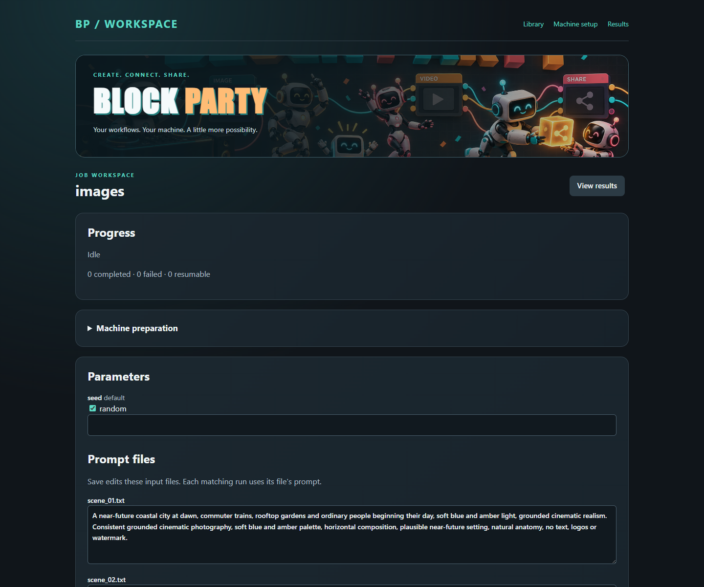
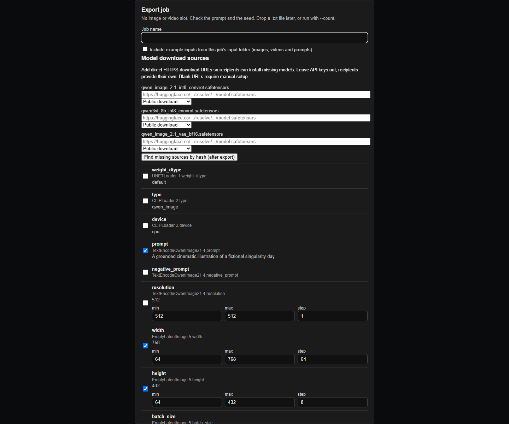
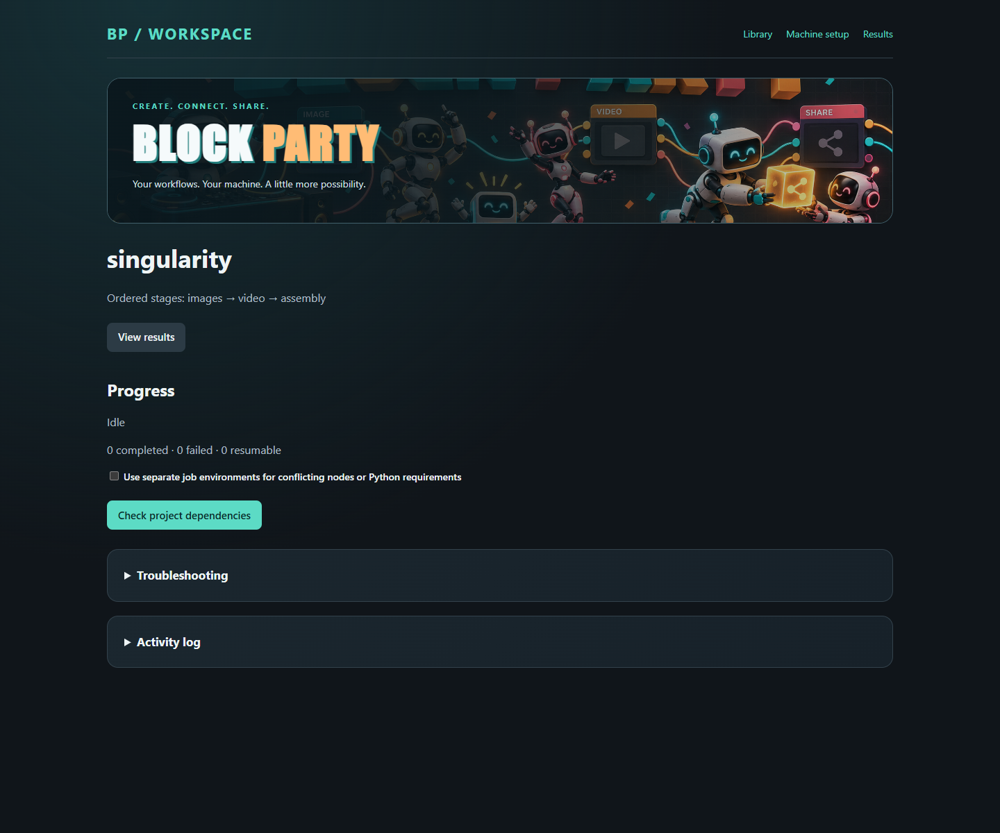

# Block Party

**Your workflow deserves an invite to the next machine.**

Block Party turns ComfyUI workflows into portable jobs you can share, unpack, and run. Bring the graph, the prompts, and the recipe. When you arrive, Block Party checks the models and custom nodes, shows what is missing, and installs the declared dependencies after you approve the plan. Give your friends a starting point they can actually use.

Start with one image, or throw a whole production party: generate images, turn them into video clips, and assemble the final film through an ordered project chain. Edit prompts in a local browser page, keep your API keys on your own computer, and package the project into a ZIP for its next stop.

A job is a folder. Drop a picture in `input/`, and its result comes back in `output/` with the same name. The graph travels with the folder. You choose which prompts, sizes, and seeds a run can change. Automatic setup needs download sources and pinned node revisions in the shared manifest; Block Party flags missing sources and conflicting dependencies before the job starts.

The launcher is still `python -m one_job`. Run it from this project folder.

Commands accept an exported job name such as `prepare my_job` or `runweb my_job`, which resolves to `jobs/my_job`. Explicit folder paths still work. Import received ZIPs from the browser library, or extract their job folders directly under `jobs/`. A job is not automatically fetched from GitHub by name.

## Start from your library

```powershell
python -m one_job
```

This opens the local browser library. `python -m one_job library` and `python -m one_job runweb` open the same page.

1. Open **Machine setup**, find your existing ComfyUI installation or enter its folder, and save the connection. Compatibility checks report Python, pip, ComfyUI connectivity, reported devices, Git, and video tools. They do not render a test image or guarantee that a particular workflow fits your GPU.
2. Drop a shared ZIP onto the library. Block Party validates it and imports the job or project, including bundled example inputs. Name collisions get a new suffix, so existing work is preserved. Imports do not install dependencies or execute workflows.
3. Open a job, add inputs or edit its prompts, and choose **Prepare and Run**. The **Workflow inputs** cards show each required reference, its thumbnail, and whether a complete set is ready. Upload directly to a card, or drop several files and review their assignments before running. Review and confirm any missing dependency downloads or installations. A ready job proceeds directly to rendering. The verified idle ComfyUI host can be started or restarted as needed.
4. Open **Results** to browse images, play supported video/audio, download files and saved API workflows, or reuse a compatible result as a new job input.

Library cards show descriptions, the latest image result, completion counts, and setup or running status. Ready reflects the last local verification; execution rechecks dependencies. Your jobs, projects, inputs, and results remain local and are ignored by Git.

For multiple references, matching workflow filenames take precedence; other uploads fill compatible empty cards in selection order. The selectors let you assign existing uploads or correct reference order. Applying assignments gives the set a fresh name and carries its matching prompt file along. Original filenames from older exports are also recognized, so three named image loaders can use their original uploaded files without manual renaming. A run with missing references stops before generation and lists what needs to be added.

The workspace uses the robot-party header, a dark theme, and responsive controls. Machine preparation, recovery, and job management live in expandable sections so the main settings remain easy to scan.

- **Save settings** saves edits without rendering. **Prepare and Run** saves, checks dependencies, and starts generation. **Run prepared job** uses the existing local preparation.
- **Save a prompt preset** remembers exposed settings and editable prompt files. Apply a preset without starting a run. Presets are local to each job; matching prompt filenames are required, and saving the same preset name updates it.
- **Manage job** lets you edit its local display name or create an independent duplicate. Duplicates keep saved parameter settings and can optionally include pending inputs. They get a unique folder and fresh preparation; run history, results, and approvals are excluded. Renaming the display name does not rename the folder or change the shared workflow contract.
- **Recently opened** on the library shows your last six jobs or projects, including after a restart.
- **Troubleshooting** copies or downloads a report with version information, host details, dependency failures, item errors, and recent Block Party logs. Known credentials and credential-bearing log lines are redacted; prompts, workflows, and credential files are excluded. Review local paths and log text before sharing. If clipboard access is unavailable, select the report text or download it.

Progress shows the current operation, completed and failed items, and download speed and estimated time remaining when the server provides a size. **Retry failed items** targets failed items and preserves completed results. **Resume unfinished work** recovers items recorded as running. Cancellation stops between items; an already queued GPU render is allowed to finish. Partial model downloads remain available for resuming. Retry refuses a failed item with partial output files until you inspect those files.

The library accepts ZIP uploads up to 512 MiB, with bounded extraction and checks for unsafe paths, links, credentials, and bundled execution state. Share contracts and example inputs, not models or local run state.

## Install on a machine that already has ComfyUI

Copy this folder to the other machine. The folder name can be `Comfyui_BlockParty`. The installer does not install ComfyUI, download models, or start the server. It links `custom_nodes/Comfyui_BlockParty` at this folder.

Windows, from this folder:

```powershell
.\install.bat --comfy C:\path\to\ComfyUI
```

Linux and macOS:

```sh
chmod +x install.sh
./install.sh --comfy /path/to/ComfyUI
```

`--comfy` can be the folder that contains `main.py`, or the parent folder that contains `ComfyUI`. Restart ComfyUI after the link is created. The menu is **Comfyui_BlockParty → Export job**.

A second run says the link is already there. `--replace` retargets that link. It will not delete a real folder of the same name.

ComfyUI has to be running. The first time on a machine:

```powershell
python -m one_job link
python -m one_job prepare jobs/dot
```

`prepare` checks the models and node packs, shows missing dependencies, and asks once before downloading models or installing pinned node packs. Matching dependencies are reused. After installation it verifies the workflow and saves approval for this computer, outside the job folder. A `state/prepared.json` that arrived with the folder does not count. Run `prepare` again after the graph changes. A new prompt does not need `prepare`.

## Preparing a received job

The easiest path is to import the ZIP into the library and choose **Prepare and Run**. You can also open an existing folder with `python -m one_job runweb jobs/<name>`. **Check dependencies** and the separate preparation controls remain available for reviewing setup without rendering. Projects review the plans for their stages before **Prepare and Run project**.



Authors enter direct HTTPS model and LoRA download URLs in the ComfyUI export dialog, along with **Public download**, **Hugging Face token**, or **Civitai API key**. Export records the local file's SHA256 and size, plus each custom node's repository and commit. Use a Hugging Face `/resolve/<revision>/<file>` URL or a Civitai `/api/download/models/<version>` URL, rather than a model web page. Prefer an immutable revision. Keys must never appear in URLs or shared manifests. Blank sources remain supported for manually installed models, but prevent automatic installation when those files are missing. Older jobs need their `models[].url` fields filled or a new export.

In a terminal, `python -m one_job prepare jobs/<name>` reviews and asks for confirmation. `--yes` explicitly approves the displayed plan for automation; `--check` retains verification-only behavior. Existing models with different hashes and existing node packs at different revisions are never overwritten. Missing node packs are cloned from HTTPS GitHub, GitLab or Codeberg repositories at the pinned revision. Their `requirements.txt`, or Python package when no requirements file exists, is installed with the linked ComfyUI Python. Arbitrary `install.py` scripts and submodules are not executed. A pack needing additional setup will still require that setup. Installing Python requirements can affect packages used by other workflows; only approve node code you trust.

Use `prepare --restart` or the browser restart checkbox to restart the verified linked ComfyUI after installing nodes and continue preparation. Restart is refused while its queue has work, when the port belongs to another process, or when process identity changes. Startup logs stay in the machine-local configuration folder. Without this option, restart manually and prepare again.

Model downloads keep partial files across cancellation and connection failures, resume with HTTP Range when supported, and restart the file if the server ignores Range. Three connection attempts use bounded backoff. Full SHA256 verification is required before publication; corrupt files are discarded. The review shows model disk estimates and preparation checks remaining free space. **Cancel preparation** stops downloads or the next installation boundary; an already running Git/pip command finishes first. Process crashes can leave `.block-party-provision.lock` or a partial-download `.lock`; remove a stale lock only after confirming no preparation process is running.

Hugging Face file-viewer URLs containing `/blob/` are converted to `/resolve/` download URLs automatically, including in older received jobs. The URL must still point to the exact file matching the manifest's SHA256 and size. A similarly named FP4/FP8 variant does not substitute for the original file. Unexpected preparation errors now show the exception type and a redacted traceback in the activity log and troubleshooting report.

Use **Use isolated environment** or `prepare --isolated --restart` for conflicting node/model versions or Python requirements. Each job gets a local ComfyUI code copy and its own Python environment; matching model files are reused, and new node requirements install into that environment. The global host link is preserved. This requires the linked Python to support `venv`; embedded Python distributions may require a full Python installation. The profile inherits base library access and is dependency isolation, not a security sandbox. An incomplete profile is retained for inspection rather than deleted automatically.

Isolation checks for `venv` and `ensurepip` before creating a profile. If portable embedded Python lacks them, use the shared environment or a full Python installation with the needed ComfyUI dependencies. An incomplete profile from an earlier attempt is reported with its exact path. Inspect and move that folder aside before retrying isolation; failed profiles are never deleted automatically.

Re-exporting the same job preserves source URLs when the model hash still matches. Changing a file invalidates its previous source. **Find missing sources by hash** attempts a Civitai lookup after the first export; sources unavailable there must be entered manually. Export reports missing URLs so authors can distinguish a portable contract from a package ready for automatic downloads.

### Gated download credentials

The browser preparation form offers one-time password fields. Keys stay in memory for that preparation and are not written to jobs, ZIPs, logs or saved parameters. In an interactive terminal, preparation prompts privately for explicitly gated dependencies. You must already have access to the model, including accepting its license or access request on the provider's site.

For repeated use, run:

```powershell
python -m one_job credentials
```

This creates an empty `downloads.env` template in Block Party's machine-local configuration folder and prints only its path. Edit it locally:

```dotenv
HF_TOKEN=your_hugging_face_read_token
CIVITAI_API_KEY=your_civitai_key
```

Environment variables with those names also work. Precedence is one-time field, environment variable, then the local file. A `.env` inside a received job is never loaded. Never include `downloads.env` in a share. Bearer credentials are sent only to the exact provider host; redirects to storage/CDN hosts do not receive the provider key. See [Hugging Face tokens](https://huggingface.co/docs/hub/security-tokens) and [Civitai authentication](https://github.com/civitai/civitai/wiki/REST-API-Reference#authorization).

Runs recheck model hashes, node commits, and installed node contents. The launcher caches hashes within a process only while file identity, size, and timestamps remain unchanged. A new process hashes them again. Dependency changes stop the job; review the change and prepare again. GGUF loaders use the same `unet`/`diffusion_models` and `text_encoders`/`clip` search order as ComfyUI.

Use workflows and custom nodes you trust. A pinned node is still Python code running with ComfyUI's permissions; this launcher is not a sandbox. Model loader filenames must be fixed values from a supported loader. Inputs generated through graph connections are rejected for those fields. Export rejects recognized credential fields; keep credentials in local node configuration and review custom-node graphs before sharing.

H3 multishot exports support `H3ModelLoaderAny`, `H3ClipLoaderAny`, and the four slots of `H3LoraStack`. GGUF variants also include the pinned ComfyUI-GGUF pack that H3 calls internally. For a GGUF H3 text encoder, select a specific `mmproj_name` instead of `(auto)` before exporting. This makes the required vision sidecar an explicit, hash-verified dependency in the shared job. Safetensors encoders do not need that sidecar selection.

The dependency audit also covers the following loaders:

| Workflow | Dependencies captured |
| --- | --- |
| Native LTX | Checkpoint or diffusion model, combined `LTXAVTextEncoderLoader` encoder/checkpoint pair, audio and video VAEs, LoRAs, latent upscalers |
| Lightricks LTX nodes | Low-VRAM checkpoint/audio-VAE/upscale loaders, IC-LoRAs, Q8 LoRAs, saved conditioning files, pinned node pack and its Python requirements |
| WanVideoWrapper | Diffusion/GGUF models, T5/cached text encoders, CLIP encoders in `clip_vision`, VAEs/tiny VAEs, VACE/extra weights, single and multi-LoRA selectors |
| Other core loaders | Image-only checkpoints, LoRA hooks and bypass loaders, video tiny-VAEs in `vae_approx`, alongside the existing Flux, SD, GGUF, and other fixed-file loaders |

Native `LoadAudio` becomes an `audio_0` input slot, so LTX audio-to-video jobs can include example audio and upload a different audio input on the receiving machine. Playback depends on the browser's supported formats. Model selectors remain fixed even when their current value is `None`; they cannot become editable parameters that introduce an undeclared model.

Preparation checks the running ComfyUI node registry as well as the installed source and Git revision. A pack that failed to import is not treated as ready. Installer failures retain a redacted log excerpt to explain missing packages or incompatible builds. After this update, prepare existing jobs once again; **Prepare and Run** does this automatically and reuses matching models.

Optional LTX Q8 kernels and selected Wan SageAttention modes are checked using the linked ComfyUI Python, including import failures. Export reports flag these additional requirements, and preparation stops before downloads when they are unavailable. Compiled kernels require a build matching Python, PyTorch, CUDA, and hardware; Block Party does not guess a GPU wheel. Use compatible kernels or a workflow without those optional patches, such as Wan's `sdpa` mode. These checks do not replace a real GPU render or guarantee sufficient VRAM.

Folder-based `LTXVGemmaCLIPModelLoader` exports are not supported yet: they require every Gemma shard plus tokenizer and configuration assets. Use a compatible single-file encoder with the native LTX loader for automatic sharing. Implicit image tiny-VAE encoder/decoder pairs, unsupported structured model selectors, and `DownloadAndLoad...` nodes also stop export instead of silently omitting files. A dedicated adapter is required for a new loader that manages additional assets internally.

Model lookup respects preferred YAML paths and the `clip`/`unet` aliases. Existing verified files in external shared libraries are reused. New downloads are published inside the linked ComfyUI installation rather than written into an external default library.

Uploads use a unique `one-job/<id>/` input folder and never request overwrite. Those uploaded files are retained so queued or resumed jobs can still read them. Individual uploads and downloaded responses are limited to 128 MB; text prompts are limited to 1 MB. The launcher reports an error for larger files.

The listener must be identifiable as the linked ComfyUI at the configured address and port. Windows uses process/socket inspection; Linux and macOS also require `lsof` and process visibility. If identity cannot be established, the launcher stops. Export is restricted to the local, same-origin ComfyUI browser page, without proxy-forwarding headers. Do not expose the export route through a reverse proxy. Restart ComfyUI and reload its browser page after updating this extension.

## Change a prompt, then queue

These are two commands.

`parameters` writes the prompt, the size, or the seed. It does not run the picture.

```powershell
python -m one_job parameters jobs/dot
python -m one_job parameters jobs/dot set text "black and white, two color serigraphic style"
python -m one_job parameters jobs/dot set noise_seed random
python -m one_job parameters jobs/dot clear text
```

`run` only reads `input/` and queues what it finds. It does not accept `set`.

```powershell
python -m one_job run jobs/dot
```

This is rejected, because `set` was attached to `run`:

```powershell
python -m one_job run jobs/dot set text "black and white, two color serigraphic style"
```

Set the text first. Then run:

```powershell
python -m one_job parameters jobs/dot set text "black and white, two color serigraphic style"
python -m one_job run jobs/dot
```

Put quotes around a value that contains spaces. The names you can set are the ones printed by `parameters` with no `set`. On `jobs/dot` those names are `text` and `noise_seed`. A job that exposes width uses the same form: `set width 768`. The value has to sit inside the min, max, and step chosen at export.

`noise_seed` (and `seed`, on a job that has one) is `random` unless you store a number. Random rolls a new seed for every file and does not write that number down. `set noise_seed 42` keeps 42 for every file. `clear text` returns that value to the default stored in the manifest.

The same values are on a page that stays on this computer. Change them, set the runs, and start. Saving does not prepare the job again.

When `input/` contains prompt `.txt` files, the page shows those files as editable text areas. Save updates the files themselves. A matching `asio_c.txt` supplies the prompt for `asio_c_0.png`, `asio_c_1.png`, and `asio_c_2.png`; the same rule applies to an image and text file sharing a stem in a one-image job. For a text-only job, Run processes the input text files instead of using a run count. Without text files, the page edits the saved prompt default as before. Edits are blocked while a run is active, and a file changed outside the page requires a reload before saving.

`state/files/` contains progress records, such as status and output filenames. For each new run, `state/workflows/` contains the actual API graph sent to ComfyUI, including the resolved seed, prompt text and uploaded input paths. The page lists these graphs under **Saved workflows**. Download one and drag its JSON into ComfyUI to inspect it. API import reconstructs the canvas layout; it does not preserve the author's original node positions.

```powershell
python -m one_job runweb jobs/dot
```

A job with no picture or video shows a runs count. That count is the same as `run --count`. A job with pictures runs the files already in `input/`. The page and the command window both show the queue and the node that is preloading or sampling. Ctrl+C closes the page. A prompt already sent to ComfyUI keeps going. Values that were not checked at export stay fixed. The page listens only on 127.0.0.1.

`run` watches the folder until you press Ctrl+C. Add `--once` to queue what is already in `input/` and exit.

A video can take several minutes after the prompt is printed. The launcher stays on that prompt and prints where it sits in the ComfyUI queue, and which node is preloading or sampling. The line updates when that changes, and at least every 30 seconds, then the finished file is copied into `output/`. Stopping the command during that wait leaves the prompt in progress. The next `run` continues it instead of starting a second one.

## Run the same picture several times

Each filename runs once. When `output/` already contains that name, a later drop is skipped.

There is no repeat count on `run`. To get several results from one picture, copy it to a different name for each result and drop the copies together. A job with one image slot accepts any filename.

```text
jobs/dot/input/shot.png
jobs/dot/input/shot_b.png
jobs/dot/input/shot_c.png
jobs/dot/input/shot_d.png
```

```powershell
python -m one_job run jobs/dot
```

Four names produce four files in `output/`. With a random seed, the four results differ.

To run a name that already finished, remove its file from `output/` (and `output/<name>_2.png` when the job saved more than one picture) and drop the picture into `input/` again. The copy kept in `state/claimed/` is not queued a second time.

A job with several slots runs when every slot has a file. Name them `image_0`, `image_1`, `video_0`, and so on, or use one prefix and the slot index:

```text
jobs/test2/input/meteor_0.jpg
jobs/test2/input/meteor_1.jpg
jobs/test2/input/meteor_2.jpg
jobs/test2/input/meteor.txt
```

`meteor_0` fills `image_0`, `meteor_1` fills `image_1`, and `meteor_2` fills `image_2`. A video slot `video_0` takes `meteor_0.mp4`. `meteor.txt` replaces the prompt for that run only. The result is named `meteor` (and `meteor_2` when the job saves a second file). A later pass of the same name starts after those files are removed from `output/`.

## Run from text only

Export accepts a graph that has a Save node and no Load Image or Load Video. Check the prompt and the seed in that dialog. Leave the seed on `random` when each run should differ. Restart ComfyUI once after this update so that dialog shows the text-only note.

A `.txt` file in `input/` is one run. Its text replaces the parameter named `text` or `prompt` for that run only. The saved default stays in place for the next file. The result uses the text file's name.

```text
jobs/poster/input/cafe.txt
jobs/poster/input/night.txt
```

```powershell
python -m one_job run jobs/poster
```

The same prompt with a new seed each time does not need a file:

```powershell
python -m one_job parameters jobs/poster set text "a quiet cafe at dusk"
python -m one_job run jobs/poster --count 4
```

That queues four runs, named `1`, `2`, `3`, and `4`. A later `--count 2` continues at the next free number. `--count` is only for a job with no image or video slot.

## Where a job comes from

Export also creates `share/<job-name>.zip` alongside `jobs/`. The ZIP contains a job folder with the API workflow, dependency manifest, generated README, and empty input/output folders. **Include example inputs** optionally adds supported media and `.txt` prompts currently in that job's `input/` folder; it does not copy claimed inputs from previous runs. Review those files before including them. Run state, previous outputs, model weights, node code and machine settings are excluded. Re-exporting a name replaces its ZIP. The success dialog has **Open share folder**.

Choose **Check export readiness** before creating the ZIP. The report lists missing model sources or node pins, estimated model download size, and required input slots. **Create ZIP** then writes the package; incomplete source information is labeled as requiring manual setup. The report does not test provider access or GPU compatibility.

Use **Download ZIP** in the export dialog to save the archive through the browser. Export remains successful when the archive is saved but automatic local preparation fails; the dialog reports that preparation separately. To package an existing job folder from the terminal, use `python -m one_job export my_job`, optionally with `--include-inputs`. This does not need a running ComfyUI.

**Open share folder** asks the file manager on the ComfyUI host to open that folder. If ComfyUI runs without an interactive desktop, a window may not appear. Use **Copy share folder path** to open it yourself, or **Download ZIP** to save the archive directly.

If export does not show a ZIP path or the new download button, update the Block Party installation loaded by ComfyUI, restart ComfyUI, and hard-refresh its browser page. When `BLOCK_PARTY_ROOT` is set, jobs and share ZIPs are written under that folder. For a missing manifest, check that extraction did not create an extra folder level such as `jobs/my_job/my_job/manifest.json`; pass that actual folder path or move the inner job folder directly into `jobs/`.



Recipients install Block Party, extract the job folder into `jobs/`, start and link ComfyUI, then open `python -m one_job runweb jobs/<job-name>` to check and approve dependency installation. The CLI prepare command also supports provisioning.

## Share and start a complete project

Project packages contain an ordered `project.json`, individual job contracts, prompt examples and caption assets. A single **Start project** runs dependency preparation, images, video clips, and fixed FFmpeg assembly. Earlier stages provide declared input slots to later jobs; a failed stage stops the chain. Existing completed job results are reused. Shared model/node pin conflicts require isolated profiles. Idle shared hosts unload models between stages; project-owned profiles stop between stages to release GPU memory.



```powershell
python -m one_job project create projects/my_film --jobs image_job video_job --duration 90 --clip-seconds 9 --captions jobs/video_job/captions
python -m one_job project export projects/my_film
python -m one_job runweb projects/my_film
```

The ZIP is `share/my_film.zip`. Extract it into `projects/` on the receiving machine. Review dependencies in the page; enable isolated environments if needed, provide gated-download tokens, and start. Terminal alternatives are `project inspect`, `project prepare`, and `project run`; preparation/run accept `--isolated`, `--restart`, and `--yes`. FFmpeg and FFprobe must be on PATH for assembly. Project cancellation applies between render/assembly steps and during downloads; submitted GPU prompts finish normally. Project manifests select built-in job and video-assembly steps and cannot provide shell commands.

Jobs and project packages are kept locally and ignored by Git. Export your own workflow or unpack a shared ZIP before following these examples; example job names in this README are placeholders. Model weights, node code, credentials, previous outputs and run state are excluded from project ZIPs. The screenshots illustrate a locally created singularity project, which is not bundled in the repository.

In ComfyUI, **Comfyui_BlockParty → Export job** writes the folder. Restart ComfyUI after this node is added or updated, or the menu item is the previous one. Check the values a run may change.

## MCP job control

Install the optional MCP dependency with the Python interpreter that will launch the server:

```powershell
python -m pip install -r requirements-mcp.txt
python -m one_job mcp
```

The server uses the official Python MCP SDK and local stdio transport. It exposes `list_jobs`, `inspect_job`, `create_job`, `update_prompt`, `update_parameter`, and `start_job`. Jobs are restricted to this project's `jobs/` directory. Tools accept job names rather than arbitrary paths; reference files must come from the template's `input/` or `state/claimed/`. Creating a job copies its workflow, manifest and explicitly selected references, including a matching `.txt` prompt. It does not copy previous run state or outputs.

A generic MCP client configuration is:

```json
{
  "mcpServers": {
    "block-party": {
      "command": "python",
      "args": ["-m", "one_job", "mcp"],
      "cwd": "E:\\CLAUDE\\BLOCK_PARTY"
    }
  }
}
```

Use the full path to your Python interpreter if the client has a different PATH. No network listener or ComfyUI restart is needed. Protocol messages use stdout; rendering logs go to `state/mcp/`.

Call `inspect_job` to find complete reference sets and missing inputs. `update_prompt` edits an existing pending `.txt` file. `update_parameter` changes only manifest-exposed values; a matching `.txt` still overrides the default text. `start_job(job, action="run")` checks dependencies and model hashes, prepares the job, then runs pending inputs in a separate worker. It returns immediately; poll `inspect_job` for logs, item status, exact workflow snapshots and results. `action="prepare"` checks without rendering. `count` is only for text-only jobs. Active MCP tasks and running item records block edits and duplicate starts within the server. Workers continue if the MCP client disconnects; task IDs are session-local, while item records, logs and outputs remain on disk. Do not run the same job simultaneously from different clients or runweb.

For MCP provisioning, call `inspect_dependencies(job)`, show the plan to the user, and obtain approval before passing its `digest` as `dependency_digest` to `start_job`. The worker rechecks the plan under a host lock and installs only those fixed dependencies, using machine-local credentials. Without a digest, MCP retains verification-only preparation. It cannot run arbitrary shell commands or restart/interrupt ComfyUI. Existing preparation and path protections apply. The transport follows the [MCP stdio specification](https://modelcontextprotocol.io/specification/2025-03-26/basic/transports).
